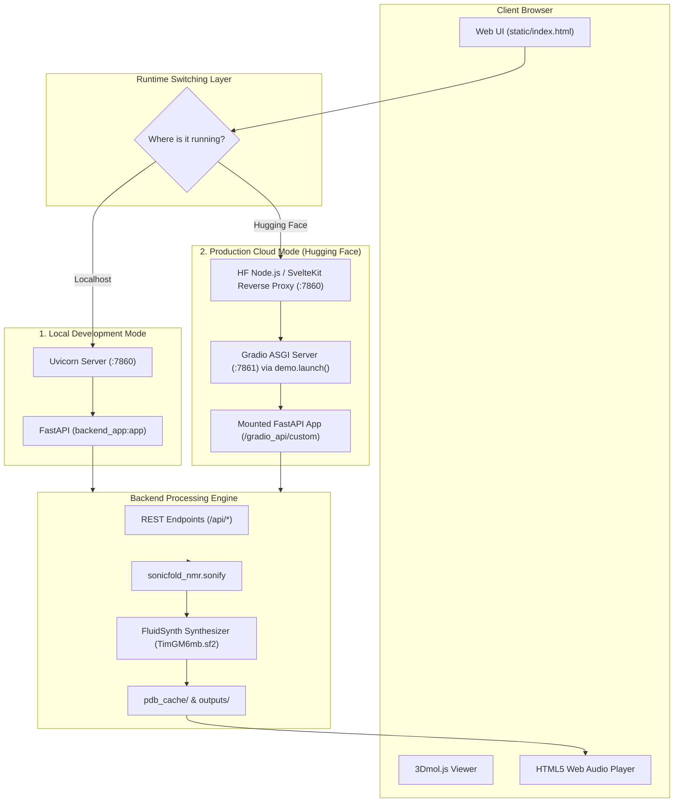
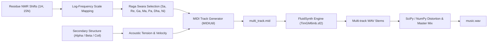

# MrFold Music Studio — Unified Master Architecture & System Documentation

> **Status**: Production Stable  
> **Release Tag**: `v1.1.0` (Commit `3e7aeb0`)  
> **Production Branch**: `main` (Frozen & Deployed on Hugging Face Spaces)  
> **Development Branch**: `exp` (Active Development)  
> **Live Space**: [https://huggingface.co/spaces/mantisa/mrfold1](https://huggingface.co/spaces/mantisa/mrfold1)  
> **Live App Direct**: [https://mantisa-mrfold1.hf.space](https://mantisa-mrfold1.hf.space)  

---

## Table of Contents
1. [Executive Summary & Scientific Background](#1-executive-summary--scientific-background)
2. [Codebase & Directory Structure](#2-codebase--directory-structure)
3. [System Architecture & Runtime Dual-Mode](#3-system-architecture--runtime-dual-mode)
4. [Hugging Face ZeroGPU & Infrastructure Assumptions](#4-hugging-face-zerogpu--infrastructure-assumptions)
5. [Reverse Proxy, ASGI Mounting & Dynamic URL Resolution](#5-reverse-proxy-asgi-mounting--dynamic-url-resolution)
6. [Sonification Engine & Musical Algorithms](#6-sonification-engine--musical-algorithms)
7. [API Specification & Data Contracts](#7-api-specification--data-contracts)
8. [Frontend, 3D Visualization & Fullscreen Architecture](#8-frontend-3d-visualization--fullscreen-architecture)
9. [Branching, Versioning & Release Model](#9-branching-versioning--release-model)
10. [Local Development, Deployment & Troubleshooting](#10-local-development-deployment--troubleshooting)

---

## 1. Executive Summary & Scientific Background

**MrFold Music Studio** is an interdisciplinary platform developed at IIT Guwahati (BioNMR Lab) that bridges **structural biology (NMR spectroscopy)** with **Indian Classical Music (Ragas)**.

### Core Scientific Concept
- **Nuclear Magnetic Resonance (NMR) Chemical Shifts**: Chemical shifts ($\delta$, measured in parts per million / ppm) of backbone nuclei ($^1\text{H}^\text{N}$ and $^{15}\text{N}$) reflect the local electronic, magnetic, and chemical environment of individual amino acid residues in a protein.
- **Sonification Mapping**: Instead of arbitrary pitch synthesis, chemical shift frequencies are mapped to the modal pitch hierarchy of traditional Indian Classical Ragas (*Yaman*, *Bhairav*, *Bhupali*, *Kafi*, *Malkauns*, and *Khamaaz*).
- **Secondary Structure Modulation**: Secondary structure elements ($\alpha$-helices, $\beta$-sheets, and disordered random coils) calculated from chemical shifts or atomic 3D coordinates modulate acoustic tension, distortion, velocity, duration, and track instrumentation.
- **Interactive Multimodal Output**: Users can concurrently visualize 3D molecular structures (via WebGL / 3Dmol.js), inspect residue-by-residue NMR tables, adjust musical parameters, and listen to synchronized multi-track audio stems rendered via FluidSynth and soundfonts.

---

## 2. Codebase & Directory Structure

```text
iitg-music/
├── app.py                             # Hugging Face ZeroGPU entrypoint (Gradio ASGI wrapper)
├── backend_app.py                     # Core FastAPI application (REST APIs + Static mounts)
├── requirements.txt                   # Python package dependencies
├── packages.txt                       # Linux system packages (fluidsynth, libsndfile1, ffmpeg)
├── Dockerfile                         # Container spec for Docker / Render deployment
├── render.yaml                        # Infrastructure-as-code for Render.com deployment
├── README.md                          # HF Space YAML metadata header & documentation
├── SOURCE_OF_TRUTH.md                 # System architecture source of truth
├── MASTER_DOCUMENTATION.md            # This unified comprehensive master document
│
├── static/                            # Frontend Web Application (HTML5 / Vanilla JS / CSS)
│   ├── index.html                     # Primary single-page interface & fullscreen controls
│   ├── app.js                         # State management, API calls, audio playback & events
│   ├── style.css                      # Modern dark theme, glassmorphic layout, fullscreen CSS
│   ├── 3Dmol-min.js                   # WebGL molecular viewer library
│   ├── icon.png                       # Studio application favicon & logo
│   └── mrfold-music-gold.png          # Studio brand banner
│
├── sonicfold_nmr/                     # Core Sonification & Musical Translation Library
│   ├── __init__.py                    # Package exports
│   └── sonify.py                      # Raga scales, pitch mapping, MIDI generation, stem mixer
│
├── pdb_cache/                         # Offline 3D coordinate cache (PDB & mmCIF files)
│   ├── 1DMB.pdb                       # Maltose Binding Protein (MBP)
│   ├── 1CA2.pdb                       # Human Carbonic Anhydrase II
│   ├── 1UBQ.pdb                       # Ubiquitin
│   └── ...                            # 40+ pre-cached structures for offline 3D rendering
│
├── outputs/                           # Dynamic generation scratch directory (WAV, MID, CSV)
│   └── {PDB_BMRB_ID}/run_{timestamp}/ # Stems, final audio, CSV timelines
│
├── 100 pdb with chemmical shift values .csv  # Master offline PDB ↔ BMRB translation dataset
├── TimGM6mb.sf2                       # Bundled General MIDI SoundFont for FluidSynth
├── batch_generate_20.py               # Batch synthesis script for 20 benchmark proteins
├── collect_20_music.py                # Research data collector
└── desktop.py                         # Standalone desktop webview runner
```

---

## 3. System Architecture & Runtime Dual-Mode

MrFold Music Studio is engineered with a **dual-runtime model**, operating with 100% parity both on standard local environments and in specialized serverless cloud environments.



---

## 4. Hugging Face ZeroGPU & Infrastructure Assumptions

### 4.1 Hugging Face Billing & Tier Gating
1. **`cpu-basic` is PRO-Gated**:
   - Hugging Face API rejects hardware changes to `cpu-basic` with:  
     `HTTP 402 Payment Required: Without a PRO subscription, you can't downgrade this Space to cpu-basic`.
   - New dynamic Gradio and Docker spaces on free `cpu-basic` are no longer permitted for non-pro accounts.
2. **ZeroGPU (`zero-a10g`) is Free for Community Spaces**:
   - The Space `mantisa/mrfold1` is allocated to `zero-a10g`.
   - ZeroGPU provides dynamic, serverless GPU allocation at zero cost.

### 4.2 Why Traditional Servers Fail on ZeroGPU
When deploying standard web applications under Hugging Face ZeroGPU (`sdk: gradio`):
- **Port 7860 is Reserved by Platform Proxy**: Hugging Face runs an internal supervisor and SvelteKit Node.js reverse proxy listening on `0.0.0.0:7860`.
- **Manual Uvicorn Crash**: If `app.py` runs `uvicorn.run(..., port=7860)`, it immediately crashes with:  
  `ERROR: [Errno 98] error while attempting to bind on address ('0.0.0.0', 7860): address already in use`.
- **ZeroGPU Detector Failure**: Because the process exits on port collision, the ZeroGPU daemon aborts before startup event validation completes, reporting:  
  `RuntimeError: No @spaces.GPU function detected during startup`.

### 4.3 The Native `demo.launch()` Solution
In [`app.py`](file:///Users/ayushsingh/developer/iitg-music/app.py):
1. Import `spaces` at module scope:
   ```python
   import spaces
   @spaces.GPU
   def dummy_gpu_fn(x=None):
       return x or "ZeroGPU Active"
   ```
2. Bind the function to a hidden Gradio button inside `gr.Blocks()`:
   ```python
   _btn = gr.Button("ZeroGPU Activator", visible=False)
   _btn.click(fn=dummy_gpu_fn, inputs=_inp, outputs=_out)
   ```
3. Call **`demo.launch()`** directly. Gradio automatically negotiates the internal port with the Hugging Face supervisor, registers lifecycle hooks, and stays healthy.

---

## 5. Reverse Proxy, ASGI Mounting & Dynamic URL Resolution

Because the Space is hosted inside Gradio, our full-stack web application is served through an embedded full-page `<iframe>` that connects to FastAPI.

### 5.1 ASGI Sub-Mount Patch (`app.py`)
```python
_original_create_app = gradio.routes.App.create_app

def _patched_create_app(cls, *args, **kwargs):
    gradio_asgi = _original_create_app(*args, **kwargs)
    try:
        # Mount our complete FastAPI application under /gradio_api/custom
        gradio_asgi.mount("/gradio_api/custom", fastapi_app, name="mrfold_custom")
        print("[app.py] ✓ Successfully mounted FastAPI app at /gradio_api/custom.")
    except Exception as e:
        print(f"[app.py] WARNING: Failed to mount FastAPI app: {e}")
    return gradio_asgi

gradio.routes.App.create_app = classmethod(_patched_create_app)
```

### 5.2 Dynamic Client-Side Path Resolution (`static/app.js`)
To allow the same JavaScript bundle to execute identically in local standalone mode (`http://127.0.0.1:7860/`) and in Hugging Face mounted mode (`https://mantisa-mrfold1.hf.space/gradio_api/custom/`):

```javascript
// 1. Detect if running inside the Gradio subpath
const API_PREFIX = window.location.pathname.includes("/gradio_api/custom") ? "/gradio_api/custom" : "";

// 2. Resolver helper
function resolveUrl(url) {
  if (!url || typeof url !== "string") return url;
  if (url.startsWith("http") || url.startsWith("blob:") || url.startsWith("data:")) return url;
  if (API_PREFIX && url.startsWith(API_PREFIX)) return url;
  if (url.startsWith("/api/") || url.startsWith("/outputs/")) {
    return `${API_PREFIX}${url}`;
  }
  return url;
}

// 3. Global window.fetch monkey-patch
const originalFetch = window.fetch;
window.fetch = function(input, init) {
  if (typeof input === "string") {
    input = resolveUrl(input);
  }
  return originalFetch(input, init);
};
```

---

## 6. Sonification Engine & Musical Algorithms

The engine translates BioNMR chemical shift arrays into MIDI events, renders audio stems through FluidSynth, and produces an expressive multi-track mix.



### 6.1 Supported Indian Classical Ragas

| Raga | Time of Day | Mood / Rasa | Swara Scale (Degrees) | Characteristic Interval |
| :--- | :--- | :--- | :--- | :--- |
| **Yaman** | Evening | Serene, Devotional, Romantic | S, R, G, M' (Teevra), P, D, N | Sharp 4th (Teevra Ma) |
| **Bhairav** | Dawn | Meditative, Solemn, Majestic | S, r (Komal), G, M, P, d (Komal), N | Flat 2nd & Flat 6th |
| **Bhupali** | Evening | Uplifting, Triumphant, Calm | S, R, G, P, D (Pentatonic) | Audav (5-note scale) |
| **Kafi** | Night / Spring | Joyful, Folk, Earthy | S, R, g (Komal), M, P, D, n (Komal) | Flat 3rd & Flat 7th |
| **Malkauns** | Midnight | Introspective, Mystical, Profound | S, g (Komal), M, d (Komal), n (Komal) | Pentatonic, omitted Pa & Re |
| **Khamaaz** | Late Evening | Sensual, Expressive, Dramatic | S, R, G, M, P, D, N (Aroha) / n (Avaroha) | Shuddha Ni ascending, Komal Ni descending |

### 6.2 Secondary Structure & Tension Mapping
- **$\alpha$-Helix**: Low structural strain $\rightarrow$ Smooth sustain, flute/violin timbre, moderate velocities (60–85).
- **$\beta$-Sheet**: High rigidity and planar tension $\rightarrow$ Staccato attacks, sitar/plucked acoustic timbre, higher velocity (85–110).
- **Random Coil / Loop**: Flexible, dynamic entropy $\rightarrow$ Fluid ornamentation, percussion syncopation, variable dynamics.

---

## 7. API Specification & Data Contracts

All endpoints are hosted by [`backend_app.py`](file:///Users/ayushsingh/developer/iitg-music/backend_app.py).

### 7.1 `GET /api/presets`
Returns predefined showcase proteins with verified BMRB chemical shift assignments and local PDB coordinates.
- **Response**:
  ```json
  {
    "presets": {
      "25237": {
        "title": "Maltose Binding Protein (MBP)",
        "bmrb_id": "25237",
        "pdb_id": "1DMB",
        "description": "Large multi-domain periplasmic binding protein."
      }
    }
  }
  ```

### 7.2 `GET /api/fetch/{identifier}`
Fetches chemical shift assignments by BMRB ID or 4-letter PDB ID.
- Automatically resolves PDB ID $\leftrightarrow$ BMRB ID using local lookup table [`100 pdb with chemmical shift values .csv`](file:///Users/ayushsingh/developer/iitg-music/100%20pdb%20with%20chemmical%20shift%20values%20.csv).
- Queries BMRB API with local file fallbacks.

### 7.3 `GET /api/pdb/{pdb_id}`
Returns the raw PDB or mmCIF coordinate file.
- Checks local [`pdb_cache/{PDB_ID}.pdb`](file:///Users/ayushsingh/developer/iitg-music/pdb_cache/) first.
- Falls back to downloading from RCSB (`https://files.rcsb.org/download/{PDB_ID}.pdb`) and automatically caches the file to disk for subsequent offline use.

### 7.4 `POST /api/sonify`
Primary synthesis endpoint.
- **Request Body**:
  ```json
  {
    "dataset": [...],
    "raga": "yaman",
    "tempo": 110,
    "root_pitch": 60,
    "tension_mode": "distortion",
    "pdb_id": "1DMB",
    "bmrb_id": "25237"
  }
  ```
- **Response**:
  ```json
  {
    "success": true,
    "audio_url": "/outputs/1DMB_BMRB25237/run_20261015_050000/music.wav",
    "midi_url": "/outputs/1DMB_BMRB25237/run_20261015_050000/music.mid",
    "stems": {
      "melody": "/outputs/.../stem_melody.wav",
      "drone": "/outputs/.../stem_drone.wav",
      "harmony": "/outputs/.../stem_harmony.wav"
    },
    "timeline": [...]
  }
  ```

### 7.5 `GET /gradio_api/startup-events`
- Special passthrough handler returning `{"is_running": true}`.
- Intercepts Gradio's internal health check to prevent 404 errors during startup.

---

## 8. Frontend, 3D Visualization & Fullscreen Architecture

### 8.1 3D Molecular Viewer (`3Dmol.js`)
- Rendered into a canvas container (`#viewer-container`).
- Supported styles: `cartoon`, `stick`, `sphere`, `cross`.
- Synchronized color mapping: Residues highlight in real-time as the audio timeline plays, matching current notes to structural amino acid residues.

### 8.2 Fullscreen Controls & Vendor Prefix Isolation
In [`static/style.css`](file:///Users/ayushsingh/developer/iitg-music/static/style.css), standard browser parsing rules state:  
*If a CSS selector list contains an unrecognized vendor prefix, the browser invalidates the ENTIRE rule block.*

Therefore, fullscreen rules MUST be declared separately:
```css
/* CORRECT: Separate rules */
:fullscreen #fullscreen-raga-options {
  display: flex !important;
  visibility: visible !important;
}

:-webkit-full-screen #fullscreen-raga-options {
  display: flex !important;
  visibility: visible !important;
}

:-moz-full-screen #fullscreen-raga-options {
  display: flex !important;
  visibility: visible !important;
}
```

---

## 9. Branching, Versioning & Release Model

| Branch | Status | Target | Deployment Trigger |
| :--- | :--- | :--- | :--- |
| **`main`** | Frozen Stable | Hugging Face Spaces & GitHub | Push to `hf main` deploys production immediately. |
| **`exp`** | Active Development | Local & GitHub `origin/exp` | All feature experiments, UI updates, and test commits. |

### Release Promotion Workflow
When a feature on `exp` is thoroughly verified:
```bash
git checkout main
git merge exp --ff-only
git tag -a v1.X.Y -m "Release v1.X.Y: description"
git push origin main --tags
git push hf main --tags
git checkout exp
```

---

## 10. Local Development, Deployment & Troubleshooting

### 10.1 Running Locally
```bash
# 1. Install Python dependencies
pip install -r requirements.txt

# 2. Run local FastAPI server directly
python3 -m uvicorn backend_app:app --host 127.0.0.1 --port 7860

# 3. Access in browser
http://127.0.0.1:7860
```

### 10.2 Troubleshooting Guide

| Symptom | Root Cause | Solution |
| :--- | :--- | :--- |
| `[Errno 98] Address already in use` | `uvicorn.run()` was invoked manually on port 7860 on Hugging Face Spaces. | Remove `uvicorn.run()` from `app.py` and call `demo.launch()` natively. |
| `RuntimeError: No @spaces.GPU function detected` | Space hardware is ZeroGPU but code has no active `@spaces.GPU` decorator. | Ensure `import spaces` is at line 1 and `@spaces.GPU` wraps a function registered in Gradio Blocks. |
| `HTTP 402 Payment Required` on hardware change | HF policy now restricts `cpu-basic` behind PRO subscriptions. | Keep the Space on free `zero-a10g` ZeroGPU hardware. |
| Fullscreen sub-panel hidden in Chrome/Firefox | Fullscreen vendor prefix selector was grouped with commas in CSS. | Separate into standalone `:fullscreen`, `:-webkit-full-screen`, and `:-moz-full-screen` blocks. |
| 3D molecular structure fails to render | RCSB network timeout or offline mode. | Verify PDB file exists in `pdb_cache/`. The `/api/pdb/{pdb_id}` route loads from cache first. |
| Sound generation fails / silent audio | FluidSynth binary or SoundFont missing. | Ensure `fluidsynth` is installed (`packages.txt` / brew / apt) and `TimGM6mb.sf2` is present in repo root. |
